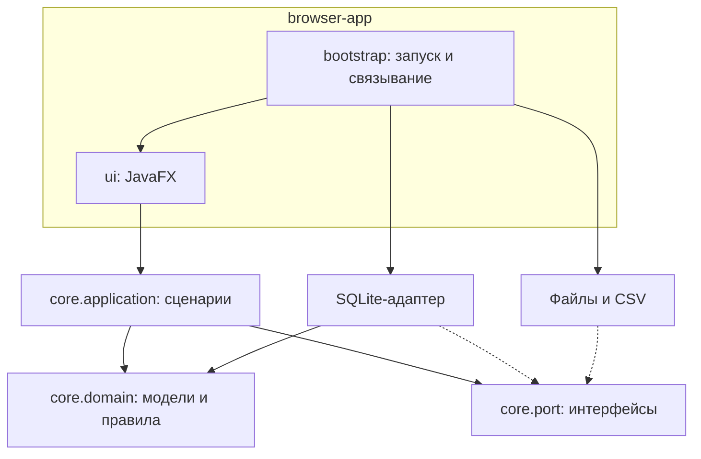
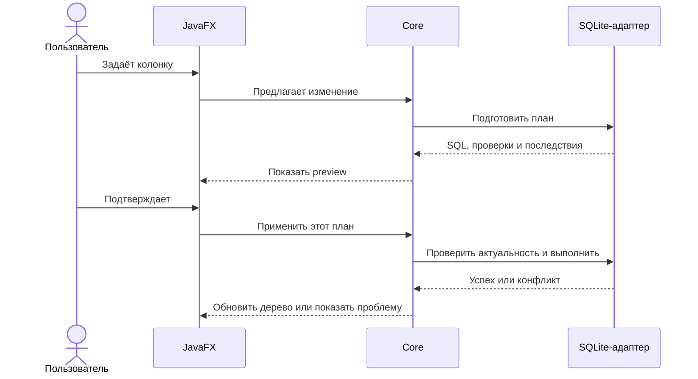

# Database Browser: архитектура

## Что строим

Десктопный клиент на **Java + JavaFX**. Сначала SQLite, затем PostgreSQL и MySQL.

Выбираем **модульный монолит**: приложение запускается одним процессом, но код разделён по обязанностям. Внешние операции выполняются через **порты и адаптеры**: порт — Java-интерфейс, адаптер — его реализация для конкретной технологии.

Главная идея: **интерфейс показывает, core управляет действиями, адаптер работает с СУБД.**

## Из каких частей состоит проект

| Модуль | За что отвечает |
|---|---|
| `browser-app` | Запуск, связывание компонентов и весь JavaFX: окна, дерево объектов, редакторы схемы и SQL, результаты и планы |
| `browser-core` | Общие модели, проверки и сценарии: подключение, изменение схемы, запросы, экспорт |
| `browser-sqlite` | JDBC, чтение схемы SQLite, генерация DDL, миграции, выполнение SQL и разбор EXPLAIN |
| `browser-io` | Запись файлов и экспорт CSV |

Внутри `browser-app` два пакета: **bootstrap** создаёт и связывает компоненты, **ui** отвечает за JavaFX. При запуске bootstrap передаёт сервисы core интерфейсу; дальше UI вызывает эти сервисы. Отдельный модуль только для запуска пока не нужен.

Внутри `core` достаточно трёх разделов:

- **domain** — модели: таблица, колонка, изменение схемы, результат запроса, узел плана.
- **application** — сервисы, управляющие сценариями пользователя.
- **port** — интерфейсы внешних операций: чтение схемы, выполнение запросов и изменений, получение плана, запись экспорта.

На схеме — зависимости кода. Пунктир означает «реализует интерфейс».

**Правило:** core не импортирует JavaFX и JDBC. Конкретные адаптеры выбирает bootstrap; пакет ui обращается к сервисам core.

## Как проходит изменение схемы

Например, пользователь добавляет колонку:

Различаем **намерение** (`SchemaChangeRequest`) и **план выполнения** (`ChangePlan`). Например, намерение — изменить ключ, а план SQLite может включать пересоздание таблицы.

Общие проверки находятся в core. Конкретный SQL, проверки данных и порядок транзакционных действий выполняет адаптер. План показывает последствия и реальные возможности отката.

## Как добавлять другие СУБД

Создаём `browser-postgres` или `browser-mysql`, реализующий те же порты.

В адаптере собраны особенности движка: метаданные, типы, DDL, транзакции и EXPLAIN. Сервисы core вызывают интерфейсы, поэтому им не требуется выбирать СУБД через многочисленные `if`.

Адаптер сообщает доступные возможности: операцию можно выполнить напрямую, через миграцию или она не поддерживается. UI учитывает это при показе действий.

**Расширяемость не означает отсутствие изменений:** новая возможность СУБД иногда потребует дополнить общую модель или редактор.

## Несколько подключений в одном окне

Приложение рассчитано на одновременную работу с несколькими БД: в MVP — с несколькими файлами SQLite, а после добавления адаптеров — также с PostgreSQL и MySQL.

Для каждого подключения core хранит отдельную **сессию** с идентификатором и нужным адаптером. Вкладка SQL и дерево объектов привязаны к выбранной сессии; запросы, результаты и транзакции разных сессий не смешиваются.

При запуске bootstrap регистрирует доступные адаптеры. Подключения открываются позже по действиям пользователя, а закрытие одного подключения не закрывает остальные.

## Как учитывать совместный доступ

Другой разработчик может изменить БД, пока пользователь смотрит preview.

Поэтому план привязывается к снимку схемы. После подтверждения адаптер получает необходимую блокировку и повторно проверяет схему и данные. При конфликте приложение предлагает новый план.

**Во время ожидания подтверждения блокировку не держим.** Не выполняем изменившийся план по старому подтверждению.

Для нескольких клиентов PostgreSQL/MySQL собственный сервер приложения пока не обязателен. Общий удалённый доступ к SQLite и совместное редактирование SQL — отдельные будущие сценарии.

## Важные правила реализации

- **JavaFX:** View показывает экран, ViewModel хранит его состояние и вызывает core. Запросы и экспорт работают в фоне.
- **Результаты:** передаём порциями, сохраняем типы значений. Полученное количество строк и общее количество — разные показатели.
- **SQL:** не добавляем автоматически LIMIT и COUNT к любому запросу. Классификатор помогает разбирать команды, но не гарантирует их безопасность.
- **Планы:** каждая СУБД разбирает свой EXPLAIN в общую модель. Исходный вывод сохраняем; неизвестный узел остаётся видимым.
- **Экспорт:** DDL — в диалекте исходной СУБД; CSV — потоком, без загрузки всего результата в память.
- **Схема:** при миграциях сохраняем связанные объекты и исходные определения. Неподдерживаемое изменение явно отклоняем.

## Работа команды и первый шаг

| Разработчик | Основная область |
|---|---|
| UI | JavaFX, переиспользуемые компоненты и запуск приложения в `browser-app` |
| DB | Соединения, метаданные, JDBC, транзакции и ошибки |
| Schema | Общие проверки схемы, SQLite DDL и миграции |
| Query | Запросы, результаты, планы и CSV |

Разделение работы не обязано совпадать с модулями: schema- и query-разработчики меняют свои части core и SQLite-адаптера. Общие интерфейсы согласует вся команда.

**По сравнению с исходной идеей:** управление сценариями переносим из `db` в `core`, а особенности SQLite собираем в адаптере. Плюсы — проще тестировать и добавлять СУБД. Цена — больше интерфейсов и необходимость соблюдать границы.

**Начинаем с рабочего пути:** подключение к SQLite → дерево схемы → SQL → ограниченный результат. Следом — создание таблицы с preview и подтверждением.

MVP включает редактирование таблиц, ограничений, индексов и представлений, экспорт DDL, SQL-консоль, планы и CSV. Мастер импорта файлов предлагаем отложить.
